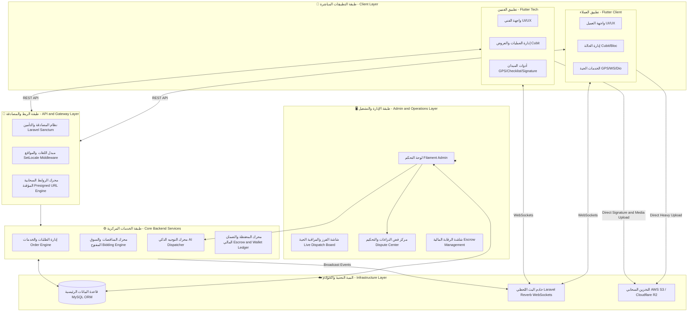
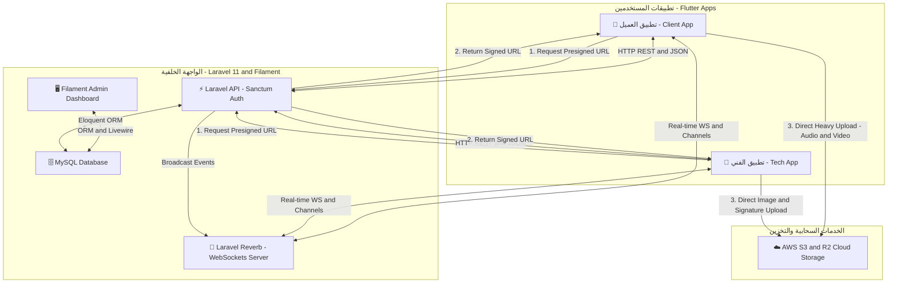
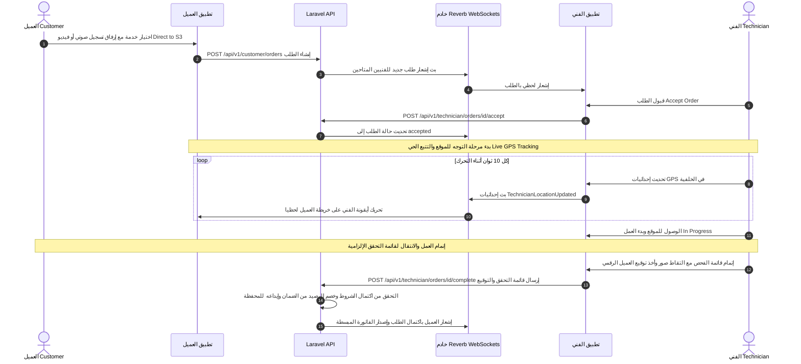
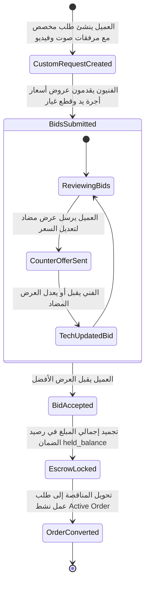
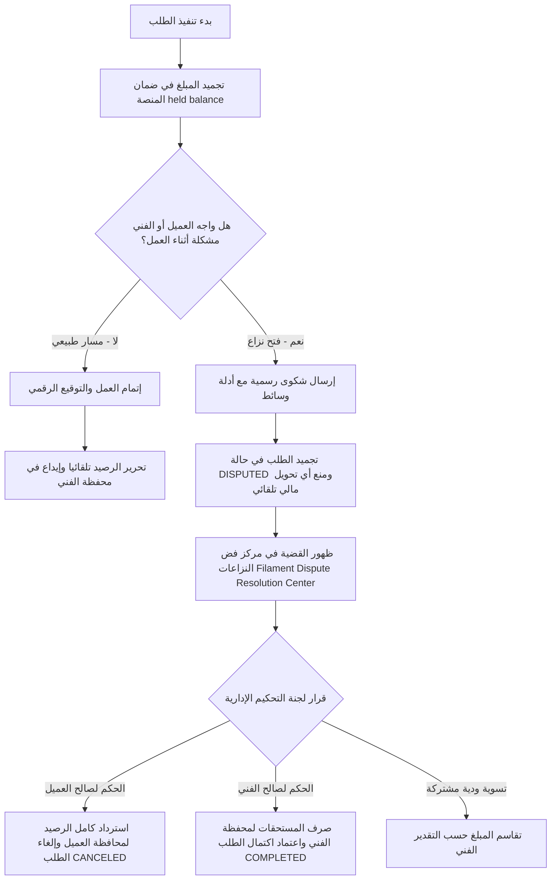
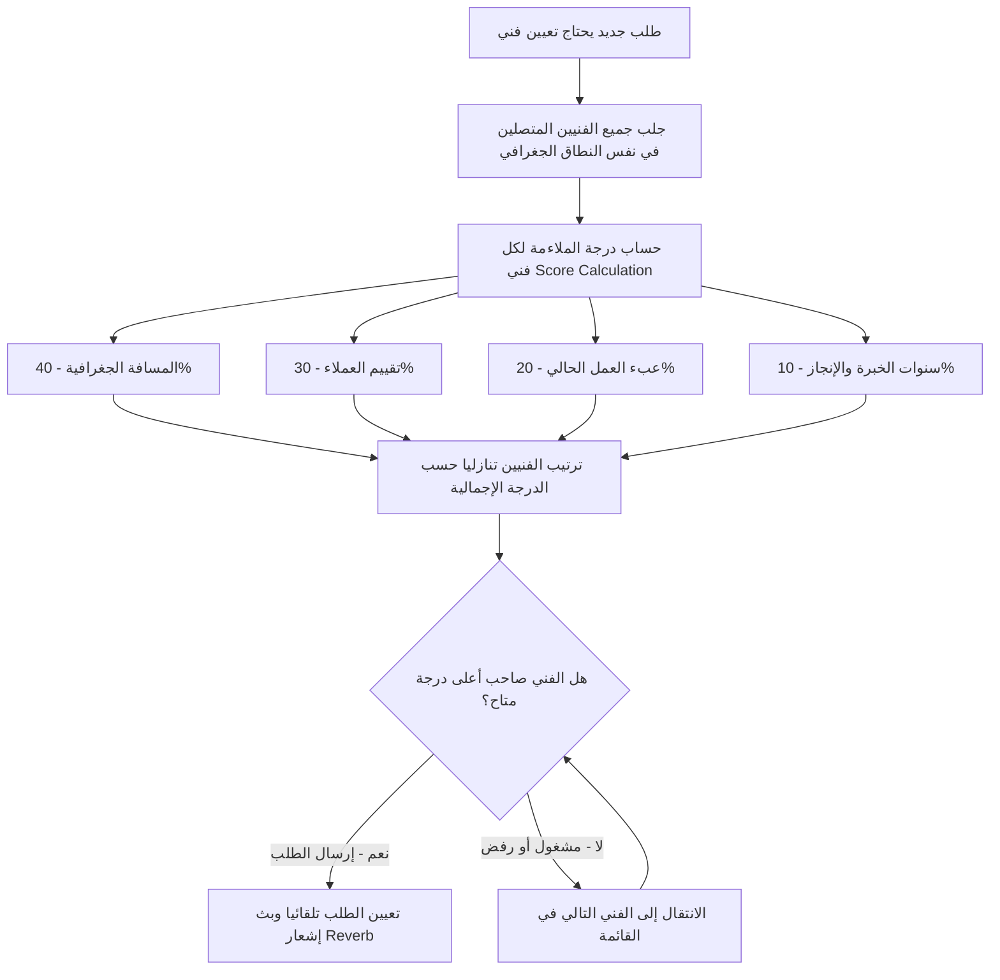
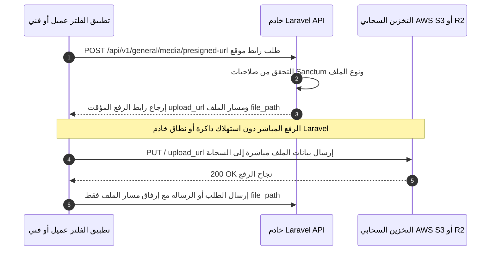
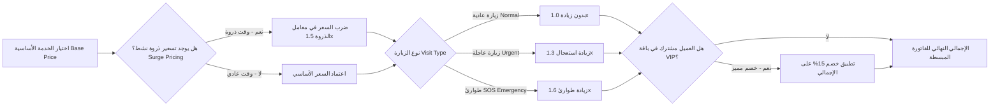
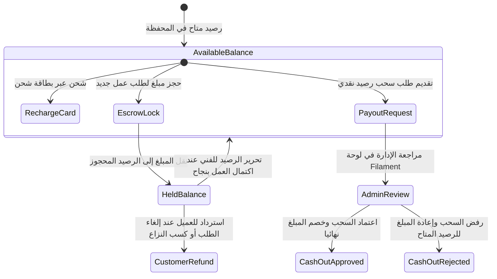
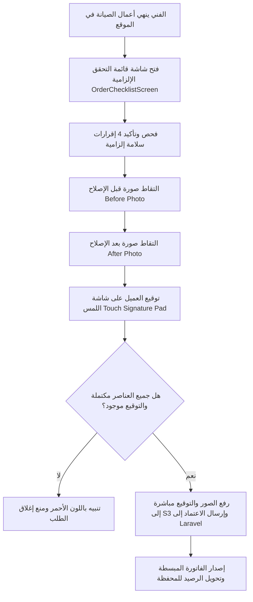

# 📚 التوثيق الشامل لمنصة "iFix Pro" (سوق الصيانة المنزلية المفتوح)

> [!IMPORTANT]
> هذا التوثيق يمثل الدليل المعماري والتقني الشامل لمنصة **iFix Pro**، ويوضح التحليل الدقيق للمشاريع الثلاثة (الواجهة الخلفية Laravel/Filament، تطبيق العملاء Flutter، وتطبيق الفنيين Flutter)، بالإضافة إلى مخططات العمل والتدفق (Mermaid Diagrams) وسجل الحلول والإصلاحات التقنية التي تم إنجازها.

---

## 🌐 1. نظرة عامة على المشروع والمعمارية العامة (Project Overview & Architecture)

منصة **iFix Pro** هي نظام متكامل وسوق مفتوح (Open Marketplace) لتقديم وطلب خدمات الصيانة المنزلية اللحظية والمجدولة، تربط بين **العملاء (Customers)** و**الفنيين المعتمدين (Technicians)** تحت إشراف وإدارة كاملة من **لوحة التحكم الإدارية (Filament Admin Dashboard)**.

### 🛠️ الحزمة التقنية (Tech Stack):
* **الواجهة الخلفية وواجهة برمجة التطبيقات (Backend & API):** إطار عمل **Laravel 11** (PHP 8.3+) مع نظام مصادقة **Laravel Sanctum**.
* **لوحة الإدارة والتشغيل (Admin Dashboard):** إطار عمل **Filament PHP (V3)** لإدارة الموارد، لوحات الفرز المباشر، الرقابة المالية، وفض النزاعات.
* **تطبيق العملاء (Customer Client App):** تم تطويره باستخدام **Flutter** (Dart) بتصميم نظيف (Clean Architecture) وإدارة حالة متقدمة عبر **Flutter Bloc / Cubit**.
* **تطبيق الفنيين (Technician App):** تم تطويره باستخدام **Flutter** (Dart) مع تركيز على التتبع الجغرافي، الملاحة، تقديم العروض في السوق المفتوح، وإدارة المهام.
* **نظام الاتصال اللحظي (Real-time WebSockets):** خادم **Laravel Reverb** لبث المواقع الجغرافية لحظياً، المحادثات المباشرة، وإشعارات المناقصات.
* **التخزين السحابي للملفات (Cloud Storage):** اعتماد معمارية **Direct-to-S3 Presigned URLs** لرفع الوسائط الثقيلة (تسجيلات صوتية، فيديوهات الشكاوى، الصور) مباشرة من تطبيقات الفلتر إلى التخزين السحابي (AWS S3 / Cloudflare R2) دون استنزاف ذاكرة أو نطاق خادم Laravel.

---

## 🏛️ 2. التحليل الهيكلي للمشاريع الثلاثة (Comprehensive Analysis of the 3 Projects)

### 🔹 المشروع الأول: الواجهة الخلفية ولوحة التحكم (Laravel API & Filament Dashboard)
تقع الواجهة الخلفية في المسار (`f:\sharef\ifix-pro\ifix-pro`)، وتدير جميع العمليات المركزية للمنصة:

1. **قاعدة البيانات والعلاقات (Database Schema & Eloquent ORM):**
   * **`users`:** جدول موحد للمستخدمين يميز بينهم عبر الرايات (`is_technician`, `is_admin`, `is_active`, `is_verified`)، ويحتوي على الأرصدة المالية (`balance`, `held_balance`)، التقييم العام (`rating`)، والإحداثيات الجغرافية (`lat`, `lng`, `is_online`).
   * **`orders`:** الكيان المحوري للطلبات المباشرة والمجدولة، يربط العميل بالفني والخدمة، ويدعم المرفقات السحابية (`audio_memo_path`, `video_path`)، وحالة الضمان (`warranty_expires_at`, `parent_order_id`).
   * **`custom_requests` & `bids`:** نظام السوق المفتوح للمناقصات؛ يطرح العميل طلب صيانة مخصص، ويقدم الفنيون عروض أسعار مفصلة (أجور يد + قطع غيار)، مع إمكانية التفاوض وإرسال عروض مضادة (Counter-Offers).
   * **`wallets` & `wallet_transactions`:** دفتر الأستاذ المالي (Financial Ledger)، يدير الأرصدة المتاحة، الأرصدة المحجوزة في الضمان (Escrow)، عمليات الشحن عبر بطاقات الشحن (`recharge_cards`)، وطلبات السحب النقدي.
   * **`order_checklists`:** قائمة فحص إلزامية قبل وبعد إنجاز العمل، تتضمن فحص السلامة، صور الإثبات، وتوقيع العميل الرقمي.
   * **`emergency_alerts` & `disputes`:** جداول إدارة الطوارئ (SOS) وفض النزاعات والتحكيم مع الحجز التلقائي للرصيد.
   * **`surge_rules` & `subscription_packages`:** محركات التسعير الديناميكي وقت الذروة وباقات الاشتراك المميزة (VIP).

2. **لوحات التحكم المتقدمة في Filament:**
   * **لوحة التوجيه والفرز الحي (`LiveDispatchBoard`):** شاشة مراقبة حية تعرض الفنيين المتاحين على الخريطة، أحمال العمل الحالية، وتتيح للمشرفين التشغيل اليدوي أو إطلاق **محرك التوجيه الذكي بالذكاء الاصطناعي (AI Dispatching Engine)** الذي يفرز الفنيين بناءً على خوارزمية متعددة المتغيرات (المسافة 40%، التقييم 30%، عبء العمل 20%، والخبرة 10%).
   * **شاشة الرقابة المالية والضمان (`EscrowManagement`):** مراقبة الأرصدة المحجوزة للمنصة وإصدار أوامر تحرير الاستحقاق أو الاسترداد اليدوي.
   * **مركز فض النزاعات والتحكيم (`DisputeResource`):** شاشة تحكيم تتيح للإدارة فحص أدلة الوسائط وإصدار أحكام قطعية: **"الحكم لصالح العميل ↩️"** (استرداد الرصيد وإلغاء الطلب) أو **"الحكم لصالح الفني ✅"** (صرف المستحقات واعتماد الطلب).

---

### 🔹 المشروع الثاني: تطبيق العملاء (Flutter Client App)
يقع في المسار (`f:\sharef\ifix-pro\client_app`)، ويعتمد على هيكلية مبرمجة بعناية لضمان أفضل تجربة مستخدم:

1. **إدارة الحالة والملاحة (Cubit & GoRouter):**
   * تم تقسيم التطبيق إلى وحدات مستقلة (Features: `auth`, `orders`, `custom_requests`, `wallet`, `services`, `profile`).
   * استخدام `GoRouter` لإدارة مسارات التنقل بسلاسة مع دعم التمرير العميق للبيانات (Extra Arguments).
2. **الميزات التنافسية الحصرية:**
   * **حاسبة التكلفة الذكية (`Smart Cost Calculator`):** تقدير فوري للتكلفة قبل تأكيد الطلب، مع تطبيق معاملات الاستعجال (1.3x عاجل، 1.6x طوارئ) وخصومات باقات VIP (15%).
   * **الرفع المباشر للوسائط (Direct-to-S3 Presigned URLs):** إمكانية إرفاق تسجيلات صوتية وفيديوهات تشرح العطل بسلاسة فائقة، حيث يطلب التطبيق رابطاً موقعاً من Laravel ويرفع الملف مباشرة للسحابة.
   * **المتابعة الجغرافية الحية (Live GPS Tracking):** خريطة تفاعلية تتابع تحرك الفني نحو موقع العميل لحظياً عبر WebSockets مع خوارزمية إعادة اتصال تصاعدية (Exponential Backoff) لحماية الخادم عند انقطاع الشبكة.
   * **المحادثة الفورية الآمنة (In-App Chat):** تبادل الرسائل والصور اللحظية مع الفني.
   * **زر استغاثة الطوارئ (SOS Emergency Button):** إرسال تنبيه فوري للإدارة مع الإحداثيات عند حدوث أي تهديد للسلامة.
   * **تتبع الضمان التلقائي (`Warranty Tracking`):** حصول العميل على ضمان 30 يوماً بعد اكتمال الطلب، مع زر لطلب "صيانة ضمان" مجانية بنقرة واحدة.

---

### 🔹 المشروع الثالث: تطبيق الفنيين (Flutter Technician App)
يقع في المسار (`f:\sharef\ifix-pro\tech_app`)، ويركز على تمكين الفني من إدارة عمله بأقصى كفاءة:

1. **التوجيه والملاحة (Proximity Sorting & Navigation):**
   * **الفرز الجغرافي الذكي:** زر **"ترتيب حسب الأقرب 📍"** في الشاشة الرئيسية يعتمد على تحديد الموقع الحالي للفني (Geolocator) وحساب المسافات الدقيقة (Haversine Formula) لإظهار الطلبات الأقرب جغرافياً.
   * **الملاحة خطوة بخطوة (Turn-by-Turn Navigation):** شاشة منبثقة تتيح للفني تشغيل التوجيه المباشر عبر تطبيق **Google Maps** أو **Waze** بنقرة واحدة للوصول لمنزل العميل دون عناء.
2. **السوق المفتوح والمناقصات (`CustomOrdersListScreen` & `SubmitOfferScreen`):**
   * استقبال تنبيهات لحظية بالطلبات المخصصة في المنطقة.
   * تقديم عروض أسعار مفصلة تفصل بين (أجرة اليد) و(تكلفة قطع الغيار المقترحة).
   * التفاوض المباشر واستقبال العروض المضادة من العملاء والرد عليها بالقبول أو التعديل.
3. **قائمة التحقق الرقمية والتوقيع (Digital Checklist & Signature Verification):**
   * شاشة فحص إلزامية (`OrderChecklistScreen`) تمنع الفني من إغلاق الطلب وتحصيل المستحقات إلا بعد إتمام:
     - إقرارات فحص السلامة وتجهيز المعدات.
     - التقاط صور إثبات الإصلاح (Before & After).
     - **لوحة توقيع العميل الرقمي (Native Touch Signature Pad):** مبرمجة بلغة Flutter الأصلية عبر `CustomPainter` و `GestureDetector` لحفظ توقيع العميل كإثبات قانوني.
4. **لوحة التحليلات المالية والأداء (`AnalyticsScreen`):**
   * رسومات بيانية تفاعلية (Bar Charts & Pie Charts عبر مكتبة `fl_chart`).
   * عرض إحصائيات الأرباح (اليومية، الأسبوعية، الشهرية)، تصنيف المهام المنجزة، ومتوسط تقييمات العملاء.

---

## 📊 3. مخططات العمل والتدفق (Mermaid Workflows & Diagrams)

### 🔹 0. المخطط الصندوقي الشامل للنظام (System Block Diagram)

---

### 🔹 1. مخطط المعمارية العامة والاتصال (System Architecture Diagram)

---

### 🔹 2. دورة حياة الطلب المباشر والتتبع الحي (Standard Order & GPS Tracking Flow)

---

### 🔹 3. تدفق السوق المفتوح والمناقصات (Open Marketplace Bidding Flow)

---

### 🔹 4. إدارة الضمان وفض النزاعات (Escrow & Dispute Arbitration Flow)

---

### 🔹 5. مخطط محرك التوجيه الذكي بالذكاء الاصطناعي (AI Dispatching Engine Flow)

---

### 🔹 6. مخطط الرفع المباشر للوسائط إلى السحابة (Direct-to-S3 Presigned URL Flow)

---

### 🔹 7. مخطط حاسبة التكلفة والتسعير الديناميكي (Smart Cost Calculator & Surge Pricing Flow)

---

### 🔹 8. مخطط دورة المحفظة المالية وسحب الأرصدة (Wallet Ledger & Payout Flow)

---

### 🔹 9. مخطط قائمة التحقق الإلزامية والتوقيع الرقمي (Digital Checklist & Signature Flow)

---

## 🛠️ 4. سجل التحليل وحل المشاكل التقنية (Remediation & Bug Fixes Log)

تم إجراء تدقيق جراحي شامل للمشاريع الثلاثة وحل جميع الاختلالات التقنية، وفيما يلي ملخص المعالجات التي تمت:

### 1️⃣ إصلاحات الأمن والكفاءة (Phase 0 Audit Fixes):
* **ثغرة سحب الأرصدة المالية (`WalletTransactionResource.php`):** تم إصلاح خطأ فادح في لوحة التحكم كان يؤدي عند اعتماد طلب سحب رصيد لفني إلى إيداع المبلغ مرة أخرى في رصيده المتاح بدلاً من خصمه من الرصيد المحجز (`held_balance`). تم تعديل المنطق ليقوم بالخصم الصحيح عند الاعتماد، وإعادة المبلغ للرصيد المتاح عند الرفض.
* **حماية الصلاحيات منعاً لـ IDOR:** إضافة قيود صارمة في واجهات الـ API لمنع العميل من الدخول بحساب فني والعكس، ومنع الفني من تقديم عروض مناقصات على طلبات مخصصة قام بإنشائها بنفسه.
* **تحسين استعلامات قاعدة البيانات (N+1 & Pagination):** استبدال استدعاءات `.get()` غير المحدودة بـ `.paginate(20)` في جميع المتحكمات (`OrderController`, `CustomRequestController`, `WalletController`) لحماية الخادم من استنزاف الذاكرة عند تضخم البيانات.
* **تحسين ذاكرة التخزين المؤقت في Flutter (`cache_helper.dart`):** فصل البيانات الحساسة (رموز Sanctum Tokens) وحفظها حصرياً في `FlutterSecureStorage` المشفر، بينما تم توجيه إعدادات واجهة المستخدم والتظاهر (Theme/Locale) إلى `SharedPreferences` لزيادة سرعة استجابة التطبيق.

### 2️⃣ معالجة مشاكل الترميز واللغة العربية (Mojibake & RTL Fixes):
* **إصلاح ترميز النصوص (UTF-8 Mojibake):** تم فحص ومعالجة جميع ملفات المصدر في Laravel و Flutter التي كانت تعاني من تشوه الحروف العربية (مثل `طلب` و `ريال`)، وتحويلها إلى نصوص عربية سليمة ومقروءة 100%.
* **توحيد المصطلحات والعملة:** اعتماد رمز العملة الموحد **`ريال` (SAR)** في كافة شاشات التطبيقين (شاشات الطلبات، الفواتير المبسطة، عروض الأسعار، والمحافظ المالية).
* **محرك الفواتير المبسطة:** تصميم فاتورة HTML/PDF بترميز Blade ناصع يدعم الاتجاهين (RTL/LTR) بسلاسة، ويعرض بوضوح (أجرة اليد، قطع الغيار، الخصم، والإجمالي) دون تعقيدات ضريبية أو رموز QR تلبيةً لاشتراطات المشروع.

### 3️⃣ معالجة أخطاء التحليل الساكن والتطابق (Static Analysis & Linting Fixes):
* **إصلاح مسارات الاستيراد في تطبيق الفنيين (`tech_app`):**
  - تصحيح استيراد `DioFactory` في شاشة `order_checklist_screen.dart` من المسار الخاطئ `network/dio_factory.dart` إلى المسار المعتمد في الهيكلية `api/dio_factory.dart`.
  - إضافة استيراد ملف المسارات `app_router.dart` المفقود في شاشتي `order_checklist_screen.dart` و `order_details_screen.dart` لحل خطأ `Undefined name 'AppRoutes'`.
* **دعم أنماط الخطوط المفقودة (`AppTextStyles`):** إضافة الأنماط النصية `titleLarge`، `titleMedium`، و `titleSmall` إلى ملف `app_text_styles.dart` في تطبيق الفنيين لحل خطأ عدم تعريف النمط في شاشة الشاشة الرئيسية (`home_screen.dart`).
* **تطابق مسارات واجهة برمجة التطبيقات (API Routing):** تسجيل مسارات فض النزاعات (`/api/v1/general/orders/{order}/dispute`) تحت مجموعة الحماية `auth:sanctum` وربطها بنجاح مع لوحة التحكم في Filament.

---

## 🏆 الخاتمة والجاهزية التشغيلية

بهذا التوثيق والمعالجات البرمجية الجراحية، أصبحت منصة **iFix Pro** متكاملة معمارياً، خالية من الثغرات وأخطاء التحليل الساكن، ومؤهلة للتوسع والتشغيل الحي بأعلى معايير الأداء والموثوقية.
